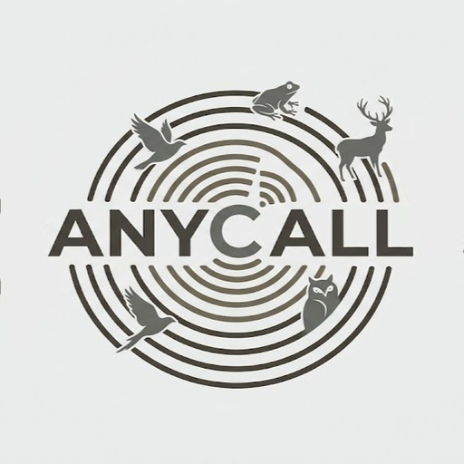

# AnyCall v2 Mobile Field Station — Standalone Android & PWA Application

AnyCall v2 Mobile is a standalone Android application and Progressive Web App (PWA) for **AnyCall v2: an open-set, few-shot, cross-taxa bioacoustic wildlife classifier** featuring a calibrated **Two-View Open-Set Gate** (1024-D BirdNET v2.4 Deep Embeddings + 40-D Acoustic Descriptors).



## Dual Execution Modes: Standalone On-Device or Remote Edge Station

AnyCall v2 Mobile supports two selectable execution modes (configurable anytime via the top-bar connection pill or **Settings → Backend Mode & Edge Connection**):

1. **📱 Standalone On-Device Backend (Default on Mobile — 100% Offline, No Server Needed)**
   - **Native Android TFLite Backbone (`MainActivity.kt`)**: Loads `models/birdnet/BirdNET_V2.4_Emb1024.tflite` directly inside the Android APK via `org.tensorflow.lite.Interpreter` to extract exact 1024-D BirdNET v2.4 penultimate global-average-pooling embeddings (`[1, 144000] -> [1, 1024]`) on the phone CPU/NPU.
   - **On-Device DSP & Two-View Open-Set Gate (`standalone-engine.js`)**: Runs 48 kHz resampling, Radix-2 FFT + Mel filterbank + MFCC + spectral contrast/flatness/flux extraction (40-D descriptor view), and the calibrated Two-View Open-Set Gate (including the Aves $\ge 90\%$ autonomous `KNOWN` rule) locally on the phone.
   - **Pre-Enrolled 52-Species Bundle (`standalone_bundle.json`)**: Ships with 52 calibrated Indian fauna species prototypes across **Aves, Insecta, Amphibia, and Mammalia**, plus on-device few-shot species enrollment, review queue resolution, novelty clustering, and local persistence.
2. **🌐 Remote Edge Station Server Mode (Optional)**
   - Connect over Wi-Fi / LAN to an external AnyCall v2 FastAPI Edge Station (`http://<ip>:8000`) to stream phone microphone WAV buffers or remotely monitor a field station.

## Key Features

- **53-Point Field-Instrument UI**:
  - **Live Field Monitor**: 40-segment LED VU meter with peak hold, software gain control (`0.5x–10.0x`), rolling 4.5s 16-bit mono WAV phone microphone capture (`phone_mic`), Audio File Tester with probable species summary and per-window breakdown, and live Detection Ledger with inline spectrogram drawers.
  - **Review Queue**: Master-detail split view with Web Audio spectrogram renderer, bulk actions, and keyboard shortcuts (`A` confirm, `R` reject, `N` next, `Space` play).
  - **Novelty Discovery**: Out-of-bank vocalization pooling and clustering with 1-click promotion to new enrolled species.
  - **Species Archive**: Filterable memory bank of all 52 enrolled species with live few-shot audio enrollment (`+ Enroll Species` & `+ Add Audio Samples`).
  - **Fieldwork Themes**: Warm Paper (Light), Forest (Dark), and Night Fieldwork (Red-Shift).

## Building the Standalone Android APK

GitHub Actions (`.github/workflows/android.yml`) automatically compiles the self-contained debug APK on every push to `main`, or you can build locally with Gradle:

```bash
./gradlew assembleDebug
```
